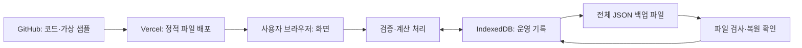

# 카페 판매·손익·재고 관리 기술 요구사항 문서(TRD)

작성일: 2026-10-12  
상태: 사용자의 ‘추천대로 완료’ 요청에 따라 1차 구현 방법을 채택한 문서. 실제 코드 작성·GitHub 저장·Vercel 배포는 아직 수행하지 않았다.

TRD는 기능을 어떤 기술과 데이터 구조로 만들고, 어떻게 저장·검사·배포할지 정리한 문서다. PRD는 제품 범위, FRD는 사용자 행동과 계산 기준, 이 문서는 그 구현 방법을 맡는다.

## 1. 기준 문서와 변경하지 않는 사항

기준은 `docs/01_PRD.md`, `docs/02_FRD.md`, `design/01_prd.md`, `design/espresso_ledger_admin/DESIGN.md`, 시안 9개 폴더의 `code.html`과 확인 가능한 PNG다. 이번에는 HTML의 버튼·입력·외부 자원·기술 표기를 다시 확인했다. `dashboard_period_p_l`, `menu_profitability`, `inventory_stock_audit`, `backup_restore`의 PNG는 정상 이미지가 아니며 `restore_modal` PNG에는 흐린 배경만 있다. 해당 화면의 구현 근거는 HTML과 FRD다.

- 한 매장·한 사용자·한 기기, 같은 브라우저에서 사용한다.
- 1차는 판매·비용 직접 입력/수정/삭제, 메뉴 수익성, 일·월 실적과 손익, 입고·폐기·재료별 실제 재고 기록, 잔량, 저장·전체 수동 백업·복원이다.
- 사용자 흐름은 판매 입력 → 메뉴 수익성 → 기간 손익·재료 잔량이다.
- FRD F01~F13과 C01~C06을 그대로 구현한다. 기술 편의를 이유로 계산·반올림·실사 순서·누락 처리·복원 절차를 바꾸지 않는다.
- 엑셀 양식/가져오기, 확장 기간, 전망·참고 발주량 등은 2차다. 임시 저장·실제 발주·POS 연동·계정 관리·CSV/인쇄·일괄 실사·공동 사용은 추가하지 않는다.
- 기획·설계·개발·검사·배포의 작업 예산은 총 4시간이다. 기술 설계는 작은 첫 버전을 위해 선택한다. 이 문서가 4시간 완료를 보장하지는 않는다.

## 2. 채택한 기술과 이유

**브라우저에서 화면·계산·저장을 수행하는 정적 웹 프로그램**으로 만든다. 정적 웹 프로그램은 Vercel이 화면 파일을 전달하고, 실제 판매·비용·재고 처리와 저장은 사용자 브라우저에서 하는 구조다.

| 역할 | 채택 기술 | 쉬운 설명과 선택 이유 |
| --- | --- | --- |
| 화면 | React + TypeScript | 화면·입력창을 재사용하고, 날짜·금액·재료 같은 값의 종류가 잘못 섞이는 실수를 줄임 |
| 개발·배포 파일 생성 | Vite | 화면 코드를 실행 가능한 HTML·JS·CSS로 묶음. Vercel에서 지원하는 간단한 배포 방식 |
| 디자인 | Tailwind CSS, 프로젝트 안에서 빌드 | 시안의 표·색·간격을 옮기기 쉬움. 시안의 외부 CDN 실행 방식은 쓰지 않음 |
| 아이콘·글꼴 | 필요한 아이콘을 로컬 포함, 시스템 한글 글꼴 | 외부 이미지·글꼴 요청을 줄이고 시안의 가짜 프로필 이미지는 제거 |
| 운영 기록 저장 | IndexedDB + Dexie | 브라우저 안의 기록 보관소. Dexie로 여러 기록의 저장을 한 묶음으로 처리 |
| 금액·수량 계산 | decimal.js | 소수 계산 오차를 줄이는 계산 도구. 원가를 중간에 임의 반올림하지 않음 |
| 입력·백업 검사 | Zod + 참조/중복 검사 함수 | 파일이나 입력이 정해 둔 자료 구조에 맞는지 확인 |
| 큰 파일 검사 | Web Worker | 큰 백업을 읽을 때 화면과 별도 작업 공간에서 검사해 화면 멈춤을 줄임 |
| 자동 검사 | Vitest, fake-indexeddb, Playwright | 계산·저장 취소·실제 브라우저의 핵심 사용 흐름을 각각 검사 |
| 코드 보관·배포 | GitHub 비공개 저장소 + Vercel | 코드 변경 이력을 보관하고 검사를 통과한 버전을 운영 주소로 제공 |
| 빌드 실행 환경 | Node.js 24.x + npm | 개발·검사·배포에서 같은 주 버전을 사용. 사용자 기기에 Node 설치는 필요 없음 |

React는 재사용 가능한 화면 단위로 구성하고, Vite는 정적 배포 파일을 만든다. Vercel은 Vite 배포를 지원한다. Node 24.x는 확인 시점 Vercel 지원 버전이다. [React](https://react.dev/learn), [Vite](https://vite.dev/guide/), [Vercel의 Vite 안내](https://vercel.com/docs/frameworks/frontend/vite), [Node 버전 안내](https://vercel.com/docs/functions/runtimes/node-js/node-js-versions).

각 라이브러리는 구현 시작 때 정식 안정 버전의 호환성을 확인하고 `package-lock.json`에 정확한 버전을 고정한다. 설치·CI·Vercel은 `npm ci`를 사용한다. 미리보기·시험 버전을 사용하거나 매 배포마다 자동 최신화하지 않는다. 개발 환경에는 Node 24의 사용할 패치 버전도 기록한다. 실제 설치하지 않은 패치 번호를 문서에서 만들어 적지 않는다.

채택하지 않는 구성은 서버 데이터베이스·서버 API·SQLite·서버 화면 렌더링·로그인·클라우드 동기화다. 시안의 SQLite/IndexedDB 혼용은 IndexedDB로 정리한다. 한 사용자 규모에서는 서버 운영·인증·동기화까지 만드는 것보다 이 구성이 4시간 범위에 적합하다.

## 3. 전체 구조와 데이터 이동

Vercel에는 코드·화면 자원·가상 샘플만 둔다. 입력한 운영 기록·복원 파일·재고 메모를 GitHub나 Vercel로 전송하는 API는 만들지 않는다. Vercel은 화면 요청에 대한 접속 정보를 처리할 수 있으므로 ‘외부 통신이 전혀 없다’고 설명하지 않는다. 운영 기록은 URL·요청·로그에 넣지 않는다.

프로그램을 처음 열 때는 인터넷으로 정적 파일과 가상 샘플을 받아야 한다. 열려 있는 화면의 저장·계산은 외부 서버 응답에 의존하지 않는다. 완전한 오프라인 재실행을 위한 PWA·서비스 워커는 1차에 추가하지 않는다.

**GitHub의 코드 보관, Vercel의 배포, 브라우저의 운영 데이터 저장, JSON 파일 백업은 서로 다른 보관 대상이다.** 코드를 되돌려 배포한다고 운영 기록까지 과거로 복원되지는 않는다.

## 4. 화면 구현과 코드 책임 분리

### 4.1 화면 이동·시안 적용

주소 끝의 `#/dashboard`, `#/sales`, `#/profitability`, `#/expenses`, `#/inventory`, `#/backup`으로 화면을 구분하는 해시 방식으로 이동한다. 같은 접속 주소 안에서 메뉴만 바뀐다. 새로고침 시에도 첫 HTML을 받을 수 있고 Vercel의 별도 경로 재작성 설정이 필요하지 않다.

공통 메뉴·기간 선택·입력칸·오류 문구·금액 표시·입력창·확인창을 재사용한다. 시안 HTML을 그대로 실행하지 않고 React 화면으로 옮긴다. 비용 목록은 FRD에 정한 날짜·항목·금액·수정·삭제를 갖춘 표로 구성한다. 입력창은 키보드로 이동·닫기·확인이 가능하게 하고 저장 전후 표시를 구분한다.

FRD에 따른 시안 수정 사항을 그대로 적용한다. 순매출/수수료 용어, 실제 메뉴·가격·단위, 1.5% 신규 기본율, 귀속일, ‘복원확인’ 문구를 사용한다. 제공되지 않은 판매 시각·주문번호는 만들지 않는다. 제외·2차 기능을 시안에 있다는 이유로 동작 버튼으로 구현하지 않는다. 시안의 ‘정상·100%·저장됨’ 문구도 실제 처리 결과 없이 고정 표시하지 않는다.

표는 현재 쪽 10/25/50/100행만 그린다. 목록 필터·쪽 이동은 계산 입력을 바꾸지 않는다. 재고 전체 11개는 한 표로 표시한다. 가로 폭이 좁으면 표 내부 가로 스크롤을 사용하고 숫자·관리 버튼을 잘라내지 않는다. 별도 모바일 전용 제품 흐름은 추가하지 않는다.

### 4.2 권장 파일 구성

| 위치 | 책임 |
| --- | --- |
| `src/app/` | 초기 실행, 공통 메뉴, 현재 화면·기간·저장 상태 |
| `src/pages/` | 대시보드·판매·수익성·비용·재고·백업 6개 화면 |
| `src/components/` | 표·기간 선택·입력창·확인창·공통 오류 표시 |
| `src/domain/` | 자료 타입, FRD 계산, 날짜·반올림·실사 흐름. 화면·DB에 의존하지 않음 |
| `src/services/` | 판매·비용·재고 저장 명령, 검증, 수정 영향 처리 |
| `src/storage/` | Dexie 구조·조회·거래 처리·버전 관리 |
| `src/backup/` | 백업 구조·생성·검사·복원 및 작업용 Worker |
| `src/validation/` | 입력·파일 형식·번호 연결·중복 검사 |
| `src/styles/` | 디자인 토큰과 프로젝트에서 빌드한 CSS |
| `public/seed/` | 공개 가능한 가상 샘플 JSON 하나 |
| `tests/` | 계산·저장·파일 왕복 검사, 브라우저 핵심 흐름 |
| `docs/` | PRD·FRD·TRD, 개발·배포·사용 안내 |

파일을 많이 나누는 것이 목적은 아니다. 같은 기준을 여러 화면에서 따로 계산하지 않도록 책임을 분리한다. 배포·도구 설정은 루트의 `package.json`, `package-lock.json`, TypeScript/Vite 설정, `vercel.json`에 둔다. 이 목록은 향후 구현 구조이며 현재 파일들이 생성되었다는 뜻이 아니다.

## 5. 저장소와 데이터 구조

### 5.1 저장 위치·보존 범위

DB 이름은 `prep-cafe-operations`로 고정하고, 초기 내부 구조 버전은 1로 둔다. 배포마다 DB 이름을 바꾸지 않는다. 운영 데이터는 동일 브라우저 프로필과 동일 출처에 속한다. 출처는 `https://호스트:포트` 조합이며 해시 화면 경로는 저장소를 나누지 않는다. [IndexedDB](https://developer.mozilla.org/en-US/docs/Web/API/IndexedDB_API), [브라우저 저장 범위와 삭제](https://developer.mozilla.org/en-US/docs/Web/API/Storage_API/Storage_quotas_and_eviction_criteria).

다른 브라우저·시크릿 창·프로필·기기·localhost·Vercel 미리보기 주소에서는 다른 보관소를 보게 된다. 운영은 고정 Production 주소 하나로 사용한다. 주소를 변경하기 전 기존 주소에서 백업하고 새 주소에서 복원한다. 재배포가 같은 운영 주소를 유지하면 기존 데이터는 유지 대상으로 취급한다.

`navigator.storage.persist()`로 지속 보관을 요청하되 브라우저가 허용하지 않아도 저장 기능을 임의 중단하지 않는다. 허용 결과는 저장 영구 보장을 뜻하지 않는다. 사용자 사이트 데이터 삭제·기기 고장에는 파일 백업이 필요하다. 시크릿 모드나 임의 브라우저 용량을 ‘영구 저장·250MB 확보’라고 약속하지 않는다.

### 5.2 보관할 자료 묶음

원본 JSON의 식별번호·자료 의미·값을 보존하면서 아래 묶음을 저장한다. 조회를 빠르게 찾는 색인을 사용한다. 색인은 책의 찾아보기와 비슷하며 별도 업무 기능이 아니다.

| 묶음 | 식별 기준·색인 | 주요 보존 내용 |
| --- | --- | --- |
| `suppliers` | 공급사ID | 공급사명·가상 자료 구분 |
| `materials` | 재료ID, 공급사ID | 이름·단위·구매용량·최초가격·납기·안전일수 |
| `menus` | 메뉴ID | 이름·기준가·분류·레시피 버전 |
| `recipes` | 버전+메뉴ID+재료ID+적용채널 | 개당 사용량·단위·빈 적용채널 |
| `priceHistory` | 재료ID+적용일, 재료ID | 구매가격·구매용량·적용일 |
| `calendar` | 날짜 | 영업·마감 여부·날씨·메모 |
| `sales` | 판매ID, 날짜, **고유 날짜+메뉴ID+채널** | 수량·당시 가격·할인·순매출·수수료·레시피·당시 개당 원가·수수료 계산 기준 |
| `openingInventory` | 재료ID+기준일 | 첫날 시작 수량·단위 |
| `inventoryEvents` | 기록ID, 날짜, 재료ID+날짜 | 유형·증감·실측량·사유·공급사·있다면 단위원가·저장순번 |
| `monthlyExpensePlan` | 월+비용항목 | 월 계획. 손익에서 중복 차감하지 않음 |
| `expenses` | 비용ID, 날짜, **고유 귀속일+항목** | 금액·원본 배분기준 또는 직접 입력 |
| `metadata` | 항목 키 | 출처·매장/자료 식별·초기 준비 완료·DB구조/계산 버전·전체 변경번호 |
| `settings` | 항목 키 | 신규 기본 수수료율 1.5%·시간대·FRD에서 채택한 계산 설정 |
| `reviewStatus` | 날짜 | 과거 기록 변경 후 확인 필요 상태 |

자료의 `dataset_id=prep-cafe-operations`, 버전 `3.1.0`을 출처에 남긴다. 단일 매장의 내부 `storeId`는 `prep-cafe`로 고정한다. 자료 버전 3.1.0, DB 구조 버전 1, 백업 형식 버전 1, 계산 규칙 버전 1은 서로 다르다. 시안의 v2.4를 사용하지 않는다. 사용자가 실제 매장으로 바꾸는 다매장 전환 기능은 만들지 않는다.

새 기록번호는 접두어와 `crypto.randomUUID()` 조합으로 생성하고 기존 S/E/X 번호는 보존한다. 수정은 기존 번호를 유지한다. 실사의 ‘최신 저장’ 판단용 증가 순번을 보관한다. 원본 재고기록의 파일 순서를 초기 순번으로 사용하고 새 기록은 그 이후 번호를 사용한다. 이는 일중 실사·시간대 기능을 추가하기 위한 정보가 아니다.

### 5.3 숫자·날짜와 원본 보존

- 금액·소수 원가·수량은 내부 및 운영 백업에서 정규화된 십진수 문자열로 보관하고, 계산할 때 decimal.js로 읽는다. 예: 소수 원가 값 `460.5`는 문자열 `"460.5"`로 보관. 이를 쉼표·원·g가 포함된 표시 문자열과 구분한다.
- 원본 JSON 숫자는 초기 준비 단계에서 같은 수치의 문자열로 바꾼다. 값의 의미를 바꾸거나 기존 원가·수수료를 새로 계산하지 않는다. 백업 버전 1은 이 문자열 자료형을 명시한다.
- 원 단위 신규 입력·판매수량·개 수량은 FRD 정수 검사, g/ml 입력은 소수 셋째 자리 검사다. 원본의 소수 원가 정밀도는 입력 제한으로 잘라내지 않는다.
- decimal.js 정밀도는 40자리로 설정하고 원가 중간 계산을 원 단위로 절삭하지 않는다. 결과 반올림은 FRD의 0.5 이상 올림과 비율 소수 첫째 자리를 따른다. 돈 계산에 일반 JS 부동소수 덧셈을 혼용하지 않는다. [decimal.js](https://mikemcl.github.io/decimal.js/).
- 신규 수수료율은 1.5%를 150/10,000이라는 정확한 비율로 처리한다. 기존 수수료율 미변경 수정은 원본 수수료/순매출을 분자·분모로 보관해, 화면에 반올림된 퍼센트로 재계산하지 않는다. 원 단위 금액의 비율 적용은 정수 곱·나눗셈으로 반올림 경계를 판정한다. 명시적 율 수정 때만 입력율 기준으로 바꾼다.
- 업무 날짜는 `YYYY-MM-DD`, 월은 `YYYY-MM`, 생성 시각은 시간대가 명시된 ISO 문자열이다. ‘오늘’과 파일명 시각은 `Asia/Seoul`로 구한다. 날짜를 UTC로 바꿔 하루 앞뒤로 이동시키지 않는다.
- 선택 날짜 유효성은 실제 날짜인지 검사한 후 범위를 검사한다. PC 시계 오류가 있으면 미래 입력·백업 생성 시각 검사에서 오류를 설명하고 PC 시계 확인을 안내한다.
- 빈칸·없는 값·0을 구분한다. 원본의 미입력 실측량을 0으로 채우지 않는다. 필수 연결이 없는 결과에는 `unavailable` 상태와 사유를 반환한다.

메뉴 이익·기간 합계·일별 잔량·재계산 실사차이는 **원본에서 얻는 계산 결과**로 메모리에 보관한다. 이를 별도 정답 데이터로 저장해 원본과 어긋나게 하지 않는다. 실제 확인량과 최초 실사차이는 기록이며 변경하지 않는다.

## 6. 초기 자료 준비·가져오기

1차 초기 자료는 `date/매장운영데이터.json`을 사용한다. 엑셀과 같은 기록이므로 둘을 합치지 않는다. 현재 파일은 약 3.46MB, 목록형 기록은 총 11,852개다. 메뉴 8·재료 11·판매 6,112·비용 3,560·재고기록 1,515 등 FRD 건수와 연결을 검사한다.

배포용 가상 샘플은 `public/seed/prep-cafe-operations-v3.1.0.json` 하나로 준비한다. 이 파일은 웹에서 볼 수 있는 공개 자원이며 실제 거래 자료를 넣지 않는다. 초기 원본 엑셀·시안 전체·실제 운영 백업을 `public`에 복사하지 않는다.

초기 실행은 DB 존재·초기 준비 완료 표시를 확인한다. 완료 표시가 없고 모든 운영 묶음이 비어 있을 때에만 샘플을 읽고 전체 검사 후 한 거래로 준비한다. 준비 완료 표시도 같은 거래 안에서 저장한다. 실패하면 빈/이전 상태를 유지한다. 초기 표시가 없는데 일부 운영 데이터가 있으면 손상 가능성을 알리고 자동 초기화를 하지 않는다.

기존 운영 자료가 있으면 새 배포·재접속 때 샘플을 다시 추가하지 않는다. 자료의 비어 있는 원본 `settings`는 FRD의 채택 기준으로 최초 준비할 때만 채운다. 최신 기본 설정을 기존 기록에 일괄 적용하지 않는다.

**1차의 사용자 파일 입력은 본 프로그램의 전체 백업 복원뿐이다.** 최초 샘플 JSON을 복원으로 받거나 엑셀 임의 가져오기 기능을 열지 않는다. 2차에는 별도 파일 어댑터를 추가하되 기존 검증·계산·저장 명령을 재사용한다. XLSX 도구 선정·양식·충돌 처리 구현은 2차 착수 시 검토하며 1차 의존성으로 설치하지 않는다.

## 7. 계산 처리와 저장 순서

### 7.1 기능별 구현 연결

| FRD 기능 | 구현 책임·입출력 | 유지하는 계산 |
| --- | --- | --- |
| F01 초기 준비 | seed loader → 검사 → 전체 DB 거래 → 초기 화면 | 원본 값 보존 |
| F02 판매 목록 | 날짜·메뉴·채널·분류 조회 → 요약/현재 쪽 분리 | 새로고침·필터로 재고 차감하지 않음 |
| F03 판매 추가 | 입력 검사 → 날짜별 원가·재료량 미리보기 → 저장 | C01/C02/C05 |
| F04 수정·삭제 | 기존 행·율 기준 읽기 → 영향 재계산 → 확인 후 변경 | 당시 원가·실측량 유지, 중복 차감 없음 |
| F05 비용 관리 | 귀속일+항목 검사 → 목록/입력/수정/삭제 → 손익 갱신 | C03/C04, 계획 중복 제외 |
| F06 메뉴 수익성 | 기간·채널 선택 → 같은 계산 모듈 → 평균·합계 | C02, 수량 가중 평균 |
| F07 기간 실적·손익 | 일·월 날짜범위 → 판매·비용·완료 상태 통합 | C03, 휴무/미마감 구분 |
| F08 재고 조회 | 기준일·재료 → 날짜별 흐름 재구성 | C05, 음수 표시·단위 유지 |
| F09 입고·폐기 | 양수 입력 → 유형에 따른 부호 → 저장 | C05/C06, 금액 자동 비용 없음 |
| F10 실사 | 실제량·사유 → 영업종료 기준 차이 → 확인 기록 저장 | C05, 최신 실측량 기준 |
| F11 저장 | DB 완료 확인 → 같은 변경번호의 화면 결과 게시 | 실패 시 원본·입력 유지 |
| F12 백업 | 전체 완료 상태 읽기 → JSON 파일 | 필터 무관 전체 자료 |
| F13 복원 | 파일검사 → 현재 백업 → 보관 확인 → 전체 거래 교체 | 기존 흐름·확인 문구·당시 값 유지 |

### 7.2 변경 명령의 공통 순서

1. 입력값과 기존 저장 상태의 변경번호를 읽는다. 입력 중에는 화면 미리보기만 계산한다.
2. 필수값·숫자·날짜·단위·중복·참조를 검사한다. 음수 잔량 같은 FRD 경고는 계산 오류와 구분한다.
3. 가상 변경 상태로 이익·손익·재고를 먼저 계산한다. 치명적 계산 오류가 있으면 기록을 쓰지 않는다. 경고 확인이 필요하면 FRD대로 먼저 확인한다.
4. Dexie 읽기/쓰기 거래 안에서 변경번호와 고유 색인을 다시 검사한다. 판매/비용/재고 변경, 영향 날짜의 확인 필요 상태, 변경번호 증가를 한 묶음으로 기록한다.
5. 거래 완료 후에만 계산 결과·목록·저장 완료 상태를 함께 갱신한다. 실패하면 이전 화면 결과와 입력을 유지한다.

거래(transaction)는 여러 변경을 전부 저장하거나 전부 취소하는 작업 단위다. 파일 읽기·다운로드·Worker 작업·네트워크 요청은 거래 밖에서 끝낸다. IndexedDB 거래 안에 관계없는 비동기 작업을 기다려 거래가 중간 종료되지 않게 한다. [Dexie 거래 처리](https://dexie.org/docs/Dexie/Dexie.transaction%28%29).

화면 명령은 한 번에 하나씩 실행한다. 전체 변경번호 확인은 오래된 화면이 새 자료를 덮어쓰는 실수를 막는 내부 보호다. FRD에서 제외한 여러 창 공동 편집·동기화 기능을 만드는 것은 아니다. 예상 변경번호가 다르면 자동 병합하지 않고 다시 읽도록 안내한다.

### 7.3 계산 모듈 구현 기준

- 판매 금액 함수는 C01만 사용한다. 순매출에서 수수료를 두 번 빼지 않는다.
- 날짜별 원가 함수는 재료별 가격이력을 정렬하고 판매일 이하의 마지막 가격을 찾는다. 레시피의 전체/포장 적용을 따른다. I10/I11 포장 구분은 데이터 연결 규칙으로 두고 시안 고정 원가를 넣지 않는다.
- 기간 집계는 계산 전 전체 유효 기록을 대상으로 한다. 합계를 쪽별 표에서 다시 더해 만들지 않는다. 원본 미결/계산 불가 상태는 합계에도 전파한다.
- 판매 날짜·메뉴·채널이 같고 수량/단가/할인만 바뀌면 FRD대로 기존 개당 원가를 유지한다. 날짜/메뉴/채널 변경 때에만 적용 원가·레시피를 다시 구한다.
- 과거 마감일 수정 영향은 변경 전·후 날짜 모두에 표시한다. 달력의 원본 마감값과 ‘변경 후 확인 필요’ 상태를 구분한다. 새 기록을 마감 완료로 만들지 않는다.
- 재고는 날짜별 입고·폐기·판매 사용량을 합친 뒤 그날 최종 실사를 적용한다. 실사조정 원본 증감과 실제 확인량을 두 번 더하지 않는다. 마지막 실사로 확인한 수량은 이후 과거 수정으로 덮어쓰지 않는다.
- 같은 날짜의 실사 여러 건은 증가 저장순번으로 최종 확인을 고른다. 이전 확인은 보관하고 일별 흐름에는 최종 확인을 한 번만 적용한다. 최초 차이와 재계산 차이를 구분한다.
- 음수 잔량·실사차이를 자동 금액 비용으로 전환하지 않는다. 예상 손익·참고 발주량 계산은 1차에서 호출하지 않는다.

내부 조회 결과에는 `ok`, `warning`, `unavailable`과 원인을 포함한다. 값이 없을 때 0이나 NaN을 정상 결과로 보내지 않는다. 모든 화면은 같은 계산 함수와 동일 변경번호의 결과를 사용한다.

## 8. 백업 파일과 복원 구현

### 8.1 전체 백업 형식

운영 백업 버전 1은 다음 항목을 가진 UTF-8 JSON이다. 모든 필수 묶음은 비어 있어도 항목을 포함한다.

| 항목 | 내용 |
| --- | --- |
| `format` | 본 프로그램 백업 식별자 `prep-cafe-backup` |
| `backupVersion` | 1 |
| `schemaVersion`, `calculationVersion` | 지원 내부 구조·FRD 계산 규칙 버전 |
| `storeId`, `datasetId` | 고정 매장/원본 자료 식별. 매장 이름만으로 일치 판단하지 않음 |
| `createdAt`, `appVersion` | 실제 생성시각·생성 앱 버전 |
| `counts`, `dateRange` | 원본에서 계산한 묶음별 실제 개수·기록 기간 |
| `data` | 5절의 전체 업무 묶음과 metadata/settings/reviewStatus |

FRD 파일명 `prep_cafe_backup_YYYYMMDD_HHMMSS.json`을 따른다. 원본 seed의 `meta.version=3.1.0`을 백업 버전으로 오인하지 않는다. 백업에 계산된 잔량 캐시를 정답으로 포함하지 않는다. 복원은 원본으로 재계산한다. 익명화·암호화·압축·CSV ZIP·개별 추출은 추가하지 않는다.

백업 생성 시 입력 명령을 잠시 막고 모든 묶음을 하나의 읽기 거래에서 읽는다. 일관된 변경번호인지 확인하고 거래 밖에서 직렬화한다. `Blob`과 다운로드 링크를 사용하며 사용이 끝나면 임시 URL을 해제한다. 실제 다운로드 위치·디스크 보관 완료를 브라우저가 확인한 것처럼 표시하지 않는다.

### 8.2 복원 단계와 실패 보존

1. 파일 크기를 먼저 확인한다. 50MB는 50,000,000바이트로 고정해 경계를 검사한다. 확장자/표시 형식뿐 아니라 실제 내용도 검사한다.
2. Worker에서 `TextDecoder`의 엄격한 UTF-8 해석, JSON 파싱, Zod 구조 검사를 한다. 외부 서버에 업로드하지 않는다. BOM이 있으면 선두 BOM만 제거한다.
3. 필수 묶음·수치·날짜·율·식별자·중복·참조·단위·순번·건수·기간을 검사한다. 본 프로그램 형식 버전 1만 받는다. 다른 형식을 추측해서 자동 변환하지 않는다. 오류에는 묶음·기록번호·필드를 표시한다.
4. 생성 시각의 미래 여부를 검사한다. 과거 손익/잔량을 미리 계산해 확인 가능한 결과와 경고를 준비한다. 음수 잔량은 구조 오류와 구분한다.
5. 파일 요약·현재/복원 건수·전체 교체 설명을 표시하고, 사용자가 빈 칸에 ‘복원확인’을 직접 입력하도록 한다. 파일 교체 시 이전 검사·문구·보관 확인을 초기화한다.
6. 현재 상태를 전체 JSON 백업으로 만들고 다운로드를 요청한다. 사용자가 파일 보관을 확인해야 교체를 진행한다. 생성 실패나 취소면 현재 데이터를 바꾸지 않는다.
7. 확인 이후 기존 변경번호가 같을 때만 전체 쓰기 거래에서 모든 묶음을 비우고 복원 내용을 넣는다. 설정·확인 상태·준비 완료 표시도 같은 거래에 포함한다. 데이터 변경번호는 현재 실행의 변경보다 큰 새 번호로 지정한다.
8. 거래가 완료되면 옛 계산 캐시·선택·미리보기를 없애고 새 자료로 화면을 구성한다. 실패하면 거래를 취소하고 기존 DB를 유지한다.

왕복 검사에서는 업무 값·설정·실사순서·확인 상태가 복원 파일과 일치해야 한다. 재시도 보호용 변경번호·현재 앱 실행 버전은 새 실행 상태를 나타내는 내부 값으로 구분하며, 이를 이유로 업무 값을 바꾸지 않는다.

Worker 완료를 기다리거나 다운로드를 실행하는 동안 DB 쓰기 거래를 열어 두지 않는다. 중간 실패 시 일부 묶음만 빈 상태로 남기는 방식으로 구현하지 않는다. 파일을 먼저 검증하고, 교체 자체는 한 거래로 한다.

프로그램 종료·브라우저 오류 등으로 결과 확인이 안 되면 재접속 후 DB 구조·자료 연결을 검사한다. 무조건 성공/복구 보장을 표시하지 않는다. DB를 읽을 수 없는 경우 오류 안내와 파일 복원 경로를 유지하며 초기 seed로 덮어쓰지 않는다. 복원 전에 만든 파일은 앱 내부의 별도 자동 복원점으로 보관하지 않는다.

### 8.3 버전 변경·배포 되돌리기

1차는 DB/백업 버전 1만 구현한다. 향후 구조 변경은 버전 증가와 변환 함수·검사를 포함해야 한다. 사용자 실측값·당시 원가를 바꾸는 변환은 허용하지 않는다. 예상하지 못한 상위 버전 DB/백업은 쓰기를 막고 지원 버전 안내를 한다.

배포를 옛 코드로 되돌릴 때 현재 DB를 그 코드가 읽을 수 있는지 먼저 확인한다. Vercel 코드 롤백과 운영 JSON 복원을 혼동하지 않는다. 운영 데이터 구조가 이미 변경된 경우 호환 가능한 수정 배포를 우선하고 원본 삭제·강제 초기화를 하지 않는다.

## 9. 개인정보·운영정보 보호

1차는 고객명·전화번호·주문 식별자·계좌·카드·지급수단·직원 개인별 급여를 수집하는 기능이 없다. 공급사명·재료 메모·비용 합계 같은 정보도 외부로 보내지 않는다. 실제 개인 식별정보를 메모에 넣지 않도록 사용 안내에 적는다.

- GitHub는 비공개로 보관하고 계정 2단계 인증을 사용한다. Vercel에는 그 저장소만 연결한다. 공개 웹 자원은 비공개 저장소 여부와 별개로 노출될 수 있으므로 공개 자원에는 가상 seed만 포함한다.
- 실제 운영 백업·실제 원본 기록·로그·스크린샷·자격증명은 Git에 커밋하지 않는다. 전용 백업/실제자료 폴더와 `.env*`·도구 인증 파일을 제외한다. 가상 샘플의 허용 파일만 명시적으로 보관한다.
- 프런트엔드의 `VITE_*` 환경값은 공개될 수 있으므로 비밀 토큰을 넣지 않는다. 1차 앱은 API 키가 필요 없다. GitHub/Vercel 배포 인증은 해당 플랫폼·개발 도구에만 둔다.
- 시안의 Tailwind CDN 스크립트·원격 프로필 이미지·Google 글꼴 요청은 제거하고 필요한 자원을 앱 빌드에 포함한다. 분석 SDK·오류 수집 서비스·외부 통계는 추가하지 않는다.
- 메모·파일 이름은 텍스트로 표시한다. HTML 실행·`eval`·무검증 객체 병합을 사용하지 않는다. 백업은 허용된 필드로 새 객체를 구성해 `__proto__` 같은 임의 키를 실행 경로에 넣지 않는다.
- 콘솔·검사 로그에는 매출액·메모·백업 내용을 통째로 출력하지 않는다. 오류 종류·기능번호·필드 위치 정도만 사용한다.
- 정상 운영은 HTTPS다. 보안 헤더는 자체 자원만 허용하는 CSP, `X-Content-Type-Options: nosniff`, `Referrer-Policy: no-referrer`, 외부 프레임 차단을 설정한다. Worker도 같은 출처에서 로드한다. [CSP](https://developer.mozilla.org/en-US/docs/Web/HTTP/Reference/Headers/Content-Security-Policy).

CSP는 코드·Worker·글꼴을 자체 출처로 제한하고 불필요한 inline script·외부 연결을 허용하지 않는다. 스타일은 빌드된 CSS를 사용하며 이 조건에서 모달·표·차트가 실제로 작동하는지 검사한다.

브라우저 운영 기록과 JSON 백업은 애플리케이션에서 암호화하지 않는다. 같은 PC·브라우저 프로필을 쓸 수 있는 사람이나 악성 확장 프로그램으로부터 완전히 보호되는 구조는 아니다. 매장 PC의 사용자 계정·화면 잠금과 백업 파일 접근 제한으로 보호한다. 별도 앱 로그인·백업 암호화는 승인 없이 추가하지 않는다.

GitHub 비공개 설정이 운영 사이트의 로그인 보호를 제공하지는 않는다. 다른 방문자는 자기 브라우저의 별도 자료를 보며 사용자 기기의 기록은 서버에서 조회할 수 없다. 가상 seed는 누구나 내려받을 수 있는 자료다. 서버 개인정보 저장이 없다는 것과 웹 페이지 자체가 비공개라는 것을 구분한다.

## 10. 처리 속도·용량 목표

다음은 구현 후 측정할 목표이며 이미 달성한 성능이 아니다. 기준은 매장용 Windows 노트북, 최신 안정 Chrome/Edge, 제공 자료 약 3.46MB와 11,852개 목록형 기록이다.

| 작업 | 목표 | 구현 방법 |
| --- | --- | --- |
| 기존 저장 자료로 화면 준비 | 자료 읽기 시작 후 2초 이내 | 한번 읽고 필요한 날짜/기준정보 색인 구성 |
| 처음 seed 준비 | 다운로드 완료 후 3초 이내 | 전체 검사 후 묶음 쓰기, 준비 중 상태 표시 |
| 판매 목록 필터·쪽 변경 | 보통 300ms 이내 | 현재 쪽만 표시, 검색 입력 150ms 지연 반영 |
| 메뉴·기간 집계·입력 미리보기 | 보통 500ms 이내 | 같은 계산 재사용, 날짜/메뉴/재료별 메모리 맵 |
| 기록 저장 후 연결 화면 반영 | 보통 1초 이내 | 일괄 재계산 결과를 한 번 갱신 |
| 제공 자료 크기의 백업·검사·복원 | 보통 5초 이내 | Worker 검사·묶음 DB 거래 |
| 허용 상한 50MB 백업 | 고정 완료시간 약속 없음 | 진행 단계 표시·교체 전 취소 가능, 메모리 실패 대응 |

재계산은 판매를 날짜·재료별로 한 번 집계하고 재고 날짜 흐름을 한 번 순회한다. 매 재료의 매 날짜에 전체 판매 목록을 반복 검색하지 않는다. 가격이력·레시피는 처음 읽을 때 작은 맵으로 묶는다. 변경번호·조회 조건으로 계산 결과를 캐시하고 변경/복원 시 지운다. 정확성을 위해 전체 재계산을 기본으로 하며 과도한 부분 갱신 구조는 만들지 않는다.

IndexedDB 용량은 브라우저·기기 여유공간에 따라 달라진다. `navigator.storage.estimate()`의 사용량·할당량은 내부 오류 진단에 참고하며 고정 50MB/250MB 저장공간을 약속하지 않는다. 50MB는 복원 파일 허용 크기이지 DB 보장 용량이 아니다. 큰 파일은 JSON 파싱·임시 객체로 파일 크기보다 많은 메모리를 사용할 수 있어, 용량·메모리 실패면 교체 전 중단하고 원본을 유지한다.

## 11. 비용 검토

요금 정보 확인일은 2026-10-12다. 실제 계정의 계약·세금·환율·사용량에 따라 금액이 달라지며 이 문서 작성은 유료 가입·구매를 실행하지 않는다.

| 항목 | 1차 비용 방향 | 이유·제한 |
| --- | --- | --- |
| React/Vite/Dexie 등 | 별도 라이선스 구매 없는 오픈소스 조합 | 채택 버전의 라이선스를 기록하고 배포에 필요한 고지를 유지 |
| 서버 DB·파일 저장·유료 API | 사용하지 않음 | 운영 데이터는 브라우저와 사용자 백업 파일에 저장 |
| GitHub | 개인 비공개 저장소, 유료 추가 기능 없이 시작 | 자동 검사 실행량에 따른 GitHub Actions 한도/비용 확인 |
| Vercel 실제 카페 운영 | **Pro 기본 월 US$20를 예산 기준** | 확인 시점 플랫폼 요금에 배포 사용자 1명·사용량 크레딧 $20 포함. 사용량·추가 좌석·부가 기능은 추가 비용 가능 |
| 개인 비상업적 샘플 확인 | 계정 조건에 맞으면 Hobby 가능 | 실제 매장 운영은 이 무료 조건으로 예산을 잡지 않음 |
| 도메인 | 기본 고정 `vercel.app` 운영 주소 사용 | 별도 도메인 구매는 필수 아님 |
| 로컬 백업 | 기존 디스크·외장 저장소 활용 | 클라우드 자동 보관 서비스를 추가하지 않음 |

Hobby는 비상업적 개인 사용으로 제한되어 실제 카페 운영에는 Pro를 추천한다. Pro는 확인 시점 기본 플랫폼 비용 $20/월이며 사용량 초과 비용이 발생할 수 있다. [Hobby 조건](https://vercel.com/docs/plans/hobby), [Pro 요금](https://vercel.com/docs/plans/pro-plan). GitHub 자동 검사는 비공개 저장소의 계정별 포함량·초과 비용을 확인한다. [GitHub Actions 비용](https://docs.github.com/en/billing/concepts/product-billing/github-actions).

Vercel Functions·서버 렌더링·DB·Analytics·유료 비밀번호 보호·추가 좌석을 붙이지 않아 사용량과 고정비를 줄인다. Vercel 계정의 지출 알림을 확인하고 초과 사용 대응을 설정한다. 정적 웹이라고 호스팅 요금·파일 전송 비용이 항상 0이라고 표현하지 않는다.

## 12. 오류 대응과 운영 복구

| 오류 | 기술 대응 | 사용자에게 보이는 결과 |
| --- | --- | --- |
| 입력·중복·연결 오류 | Zod 검사 + 참조/고유 색인 검사 | 해당 필드·기존 기록 안내, 저장 전 중단 |
| 가격·레시피 누락 | 계산 `unavailable` 반환 | 계산 불가와 빠진 정보 표시, 0으로 대체 안 함 |
| 음수 잔량 | 경고 상태, FRD 확인 절차 | 판매는 보존, 폐기는 확인 후 저장, 실측 음수는 차단 |
| 오래된 화면/변경 충돌 | 변경번호 확인, 거래 취소 | 새 자료를 다시 읽도록 안내, 자동 병합 없음 |
| DB 공간·접근 오류 | 거래 실패 처리, 메모리 결과 게시 안 함 | 저장 실패·입력 유지·기존 원본 보존 |
| 앱 재실행 시 손상 | 초기 완료/구조/자료 연결 검사 | 오류와 복원 경로, seed 덮어쓰기 없음 |
| 파일 크기·UTF-8·형식·버전 오류 | 파일/Worker 검증에서 중단 | 파일·묶음·필드 오류, 복원 비활성 |
| 검사 Worker 종료·메모리 실패 | 임시 작업 폐기 | 검사 실패, 현재 DB 변경 없음 |
| 다운로드 실패 | Blob/다운로드 요청 실패 처리 | 생성/요청 실패 안내, 보관 성공으로 표시 안 함 |
| 복원 교체 실패 | 전체 거래 취소 | 기존 상태 확인·실패 안내, 이전 백업 복구 안내 |
| 화면 코드 오류 | React Error Boundary | 오류 화면과 재접속/백업 복원 안내, 전체 DB 삭제 없음 |
| Vercel 접속 불가 | 새 파일 로드 실패 구분 | 재접속 안내. 이미 열린 화면의 로컬 저장은 서버 성공과 무관 |
| 배포 코드 오류 | 호환 여부 확인 후 이전 배포 또는 수정 배포 | 데이터와 코드 되돌리기 구분 |

저장·복원을 성공했는지 모르는 경우 자동 재실행하지 않는다. 재시도 전 현재 변경번호·대상 기록을 다시 확인해 중복 저장을 막는다. 오류 기록을 원격 서비스로 보내지 않는다. 원본 유지가 확인되지 않은 사고는 복구 완료로 표시하지 않는다.

## 13. 검사 계획과 GitHub·Vercel 배포

### 13.1 필요한 검사

| 수준 | 도구·검사 내용 |
| --- | --- |
| 계산 | Vitest로 FRD 예제 38,000원/570원/32,830원/86.4%, 당시 원가 유지, 0 매출, 반올림 경계, 수량 가중 평균, 계획 중복 제외 |
| 날짜·실사 | 한국 날짜·월 양끝·미래 날짜·9월 확정 영업일 16일, 실사 900g→다음날 700g, 같은 날 재확인, 과거 수정 후 실측량 유지 |
| 저장 | fake-indexeddb로 초기 준비 중복 방지, 고유 색인, 거래 중 예외 시 원본 보존, 확인 상태·변경번호 함께 반영 |
| 파일 왕복 | 전체 백업→변경→복원으로 모든 묶음·값·원가·실측량·설정·상태 확인. 누락·다른 매장·중복·UTF-8·크기·상위 버전·미래 시각 오류 |
| 실제 브라우저 | Playwright의 Chromium으로 판매 입력→수익성→손익·재고, 비용 수정/삭제, 입고/폐기/실사, 재접속 보존, 취소, 백업 보관 확인→전체 복원 |
| 배포 점검 | 고정 운영 주소·HTTPS·외부 자원 차단·데이터 전송 없음·화면 새로고침·브라우저 실제 IndexedDB·파일 다운로드 확인 |

테스트 도구의 가짜 DB 검사만으로 브라우저 저장·용량·복원이 실제로 된다고 판단하지 않는다. 실제 브라우저 검사를 병행한다. 검사 자료는 가상 샘플·임시 DB로 사용하고 운영 DB를 검사 목적으로 덮어쓰지 않는다. [Vitest](https://vitest.dev/guide/).

### 13.2 코드 보관과 배포 설정

GitHub 저장소는 비공개, 기본 운영 브랜치는 `main`으로 구성한다. 문서·코드·가상 샘플·lockfile·검사를 함께 보관한다. 실제 운영 백업·토큰은 제외한다. 기능 변경은 작업 브랜치에서 검사를 통과한 뒤 `main`에 반영한다.

| Vercel 설정 | 값 |
| --- | --- |
| 연결 | 지정 GitHub 비공개 저장소 |
| Framework | Vite |
| 프로젝트 루트 | 저장소 루트 |
| Node | 24.x |
| 설치 명령 | `npm ci` |
| 빌드 명령 | `npm run release` |
| 출력 폴더 | `dist` |
| 운영 브랜치 | `main` |
| 운영 URL | 한 개의 고정 Production URL |
| 서버 함수·API·DB | 없음 |
| 앱 비밀 환경변수 | 없음 |

`release`는 TypeScript 검사·핵심 단위/저장 검사·Vite 빌드를 순서대로 실행하고 하나라도 실패하면 실패 종료하는 프로젝트 스크립트로 구현한다. 브라우저 전체 흐름 검사는 GitHub CI 또는 개발 환경에서 운영 반영 전에 수행한다. CI에도 Node 24와 lockfile을 사용한다. 실패한 검사를 빌드가 성공했다는 이유로 생략하지 않는다.

Vercel의 GitHub 연결은 변경별 미리보기와 운영 배포를 제공한다. [GitHub 연결 안내](https://vercel.com/docs/git/vercel-for-github). 미리보기는 가상 자료만 사용한다. 미리보기와 Production의 주소가 달라 로컬 자료가 자동으로 이동하지 않는다는 안내를 개발·사용 문서에 남긴다.

배포 전 보안 헤더·외부 요청·public 파일 목록과 소스의 실제정보 포함 여부를 확인한다. 운영 주소를 확정하고 그 주소에서 핵심 흐름·재접속·백업·복원을 점검한다. 배포 URL과 코드 버전·검사 결과·DB/백업 호환 버전을 기록한다. 구현 시점의 GitHub/Vercel 계정·프로젝트 권한과 Pro 결제 상태는 실제로 확인한다. 현재 연결·권한·결제 완료를 추정하지 않는다.

### 13.3 4시간 작업 예산 유지

PRD의 기획 25분·설계 30분·개발 130분·검사 35분·배포 20분을 유지한다. 구현은 공통 계산·DB→판매/비용→수익성/손익→재고/실사→백업/복원 순으로 진행하고 마지막에 핵심 흐름을 연결한다. 디자인은 제공 시안을 재사용하고 별도 분석 서비스·서버·계정·2차 기능을 붙이지 않는다.

계정 연결·결제·브라우저 제약·50MB 상한 검사에서 시간이 더 필요하면 현재 완료 수준과 남은 검사를 명시한다. 필수 저장·복원 검사를 생략하거나 FRD 기능을 조용히 삭제해 ‘4시간 완료’라고 보고하지 않는다. 이 문서 단계에서는 구현·검사·배포를 시작하지 않는다.

## 14. 완료 기준과 후속 범위

TRD 기준 구현 완료는 FRD F01~F13와 C01~C06의 실제 검사, 동일 코드·데이터 구조의 재접속 보존과 백업 왕복, 고정 운영 URL의 실행 확인까지 포함한다. GitHub 코드 링크·Vercel 운영 URL·검사 결과를 확인해야 완료를 보고한다.

2차의 엑셀 어댑터·확장 기간·전망·참고 발주량·메뉴/가격/레시피 편집·월계획 배분·등급/비교·자동 백업/공유는 PRD·FRD의 후속 범위로 유지한다. 현재 도메인 계산·저장 인터페이스를 재사용할 수 있게 분리하지만 1차에 구현하지 않는다. 클라우드 DB·로그인·다기기 데이터 이전을 기술 선택만으로 추가하지 않는다.

이 문서는 기술 선택을 완료했다. 실제 계정·프로젝트 식별자·배포 주소와 설치된 패치 버전은 아직 생성·확인하지 않았으므로 구현 시점에 기록한다. 이는 미완성 기능 결정이 아니라 외부 환경의 확인 대상이다.
